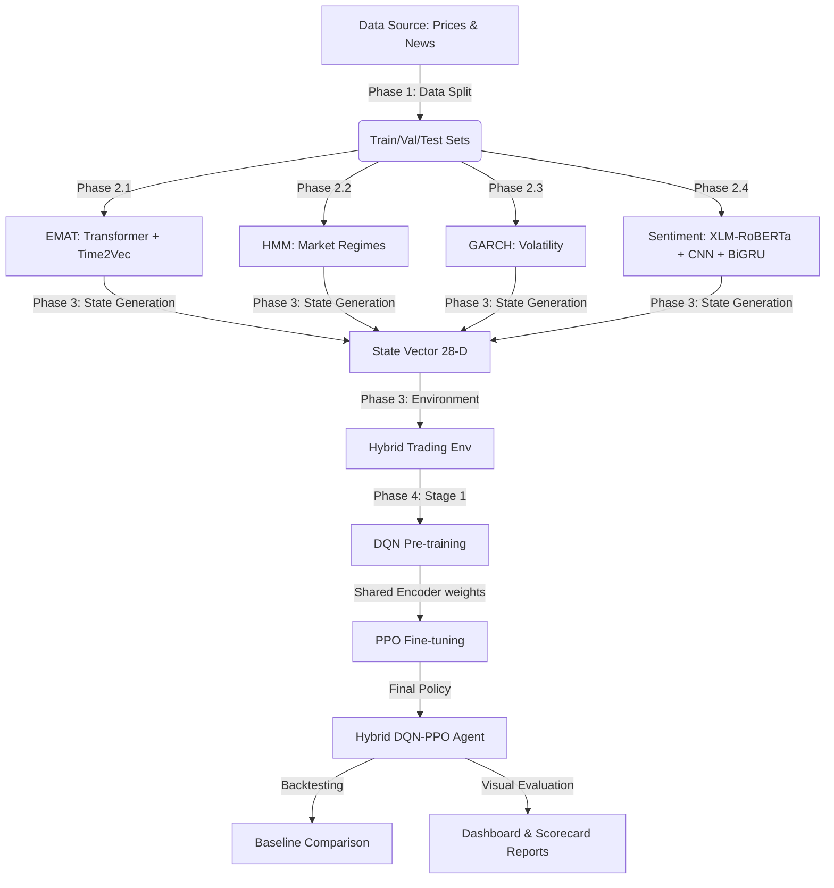

# 📈 EMAT Trading Pipeline: Mô hình Giao dịch Thuật toán Lai dựa trên Học máy Tăng cường & Tín hiệu Đa chiều

Dự án này triển khai một Pipeline huấn luyện và backtesting đầu-cuối (End-to-End MLOps Pipeline) cho hệ thống giao dịch tự động thông minh. Hệ thống sử dụng một tác nhân học máy tăng cường lai (Hybrid RL Agent) dựa trên các tín hiệu thị trường đa chiều chất lượng cao để đưa ra các quyết định giao dịch tối ưu cho 3 mã cổ phiếu mục tiêu: **GOOGL**, **META**, và **VNM**.

---

## 🧭 Kiến trúc Hệ thống & Luồng Dữ liệu

Quy trình hoạt động của hệ thống được chia làm 4 pha chính (Phases), kết hợp sức mạnh của phân tích kỹ thuật, học sâu thời gian, phân tích cảm xúc tin tức, mô hình kinh tế lượng và học máy tăng cường:



---

## 📁 Cấu trúc Thư mục Dự án

```text
EMAT/
├── src/                        # Mã nguồn cốt lõi của pipeline
│   ├── config.py               # Cấu hình tập trung toàn hệ thống (hyperparameters, paths)
│   ├── phase1_data_split.py    # Đồng bộ hóa và phân chia dữ liệu Train/Val/Test
│   ├── phase2_train_emat.py    # Huấn luyện mô hình EMAT (Transformer + Time2Vec)
│   ├── phase2_train_hmm.py     # Huấn luyện HMM phân tích trạng thái thị trường
│   ├── phase2_train_garch.py   # Huấn luyện GARCH phân tích độ biến động
│   ├── phase2_train_sentiment.py # Huấn luyện XLM-RoBERTa + CNN + BiGRU phân tích tin tức
│   ├── phase3_generate_states.py # Ghép nối đặc trưng để tạo vector trạng thái 28 chiều
│   ├── phase3_trading_env.py   # Môi trường giả lập giao dịch (Gymnasium Environment)
│   ├── phase4_hybrid_agent.py  # Định nghĩa mạng nơ-ron Hybrid Agent (DQN + PPO)
│   ├── phase4_train_agent.py   # Huấn luyện Hybrid Agent qua 2 giai đoạn (DQN -> PPO)
│   ├── run_pipeline.py         # Script điều phối chạy tự động toàn bộ 4 Phase
│   ├── plot_paper_figures.py   # Script vẽ biểu đồ phục vụ cho viết bài báo khoa học
│   └── advanced_metrics.py     # Các hàm tính toán chỉ số tài chính nâng cao (Sharpe, Calmar, MaxDD,...)
├── data_src/                   # Dữ liệu đầu vào thô (Prices, News, Sentiment)
├── data/                       # Dữ liệu sau khi đã tiền xử lý và chia tách (Train/Val/Test)
├── models/                     # Thư mục lưu trữ các checkpoint mô hình đã huấn luyện
├── states/                     # Thư mục chứa các file trạng thái (State Vectors) đã tạo
├── results/                    # Kết quả đánh giá
│   ├── metrics/                # Các tệp kết quả định dạng JSON, CSV
│   └── plots/                  # Biểu đồ phân tích hiệu năng (01_emat_performance.png,...)
├── baseline_comparison.py      # Backtesting so sánh Agent với các chiến lược Baseline
├── generate_report.py          # Sinh toàn bộ 10 biểu đồ dashboard đánh giá hệ thống
└── create_notebook.py          # Tạo Jupyter Notebook phân tích tương tác tự động
```

---

## 🛠️ Cài đặt & Cấu hình

### 1. Cài đặt môi trường
Đảm bảo bạn đã cài đặt đầy đủ các thư viện cần thiết:
```bash
pip install torch numpy pandas scikit-learn matplotlib arch hmmlearn gymnasium nbformat
```

### 2. Quản lý cấu hình tập trung
Mọi tham số cấu hình, siêu tham số (hyperparameters), đường dẫn dữ liệu đều được quản lý tập trung tại [src/config.py](file:///d:/HUTECH/thayKhang/EMAT/src/config.py). Bạn có thể dễ dàng điều chỉnh các tham số như:
*   Mã cổ phiếu mục tiêu: `SYMBOLS = ["GOOGL", "META", "VNM"]`
*   Tỷ lệ chia dữ liệu: Train/Val/Test (70% / 10% / 20%).
*   Phí giao dịch: `TRANSACTION_COST = 0.001` (0.1% mỗi lệnh).
*   Thời gian cấm giao dịch liên tiếp: `TRADE_COOLDOWN_STEPS = 10` (tránh hiện tượng giao dịch quá mức - churning).

---

## 🚀 Quy trình Huấn luyện Toàn bộ Pipeline (4 Phases)

Để bắt đầu quy trình huấn luyện tự động từ đầu đến cuối cho tất cả các mô hình, hãy chạy lệnh sau:
```bash
python src/run_pipeline.py
```
Quy trình sẽ tự động thực hiện tuần tự qua các Phase sau:

### 🔹 Phase 1: Phân chia Dữ liệu Đồng bộ
*   **Tệp thực thi:** [src/phase1_data_split.py](file:///d:/HUTECH/thayKhang/EMAT/src/phase1_data_split.py)
*   **Nhiệm vụ:** Đọc dữ liệu thô, đồng bộ hóa thời gian giữa giá cổ phiếu và ngày xuất bản tin tức. Thực hiện quy tắc **backward-shift**: dồn ngược tin tức cuối tuần (Thứ 7 & Chủ Nhật) về ngày Thứ 6 trước đó làm đầu vào dự đoán cho phiên mở cửa Thứ 2. Chia tập dữ liệu thành `train`, `val`, và `test`.

### 🔹 Phase 2: Huấn luyện các mô hình trích xuất đặc trưng (Feature Extractors)
1.  **EMAT Model (Phase 2.1):** 
    *   **Tệp thực thi:** [src/phase2_train_emat.py](file:///d:/HUTECH/thayKhang/EMAT/src/phase2_train_emat.py)
    *   **Chi tiết:** Mô hình **Enhanced Multi-Aspect Attention Transformer** kết hợp biểu diễn nhúng thời gian **Time2Vec** để dự báo tỷ suất sinh lời kỳ hạn 1, 3, và 5 ngày tới. Đánh giá chất lượng bằng chỉ số tương quan xếp hạng **Spearman Rank Information Coefficient (Rank IC)**.
2.  **HMM Model (Phase 2.2):**
    *   **Tệp thực thi:** [src/phase2_train_hmm.py](file:///d:/HUTECH/thayKhang/EMAT/src/phase2_train_hmm.py)
    *   **Chi tiết:** Huấn luyện mô hình Markov ẩn (Hidden Markov Model) để tự động nhận diện và phân loại trạng thái thị trường (Market Regimes: Tăng trưởng - Bullish, Đi ngang - Sideways, Suy thoái/Rủi ro - Bearish).
3.  **GARCH Model (Phase 2.3):**
    *   **Tệp thực thi:** [src/phase2_train_garch.py](file:///d:/HUTECH/thayKhang/EMAT/src/phase2_train_garch.py)
    *   **Chi tiết:** Ước lượng phương sai thay đổi điều kiện tự hồi quy (GARCH(1,1)) để đo lường và dự báo mức độ biến động (Volatility) ngắn hạn của thị trường.
4.  **Sentiment Model (Phase 2.4):**
    *   **Tệp thực thi:** [src/phase2_train_sentiment.py](file:///d:/HUTECH/thayKhang/EMAT/src/phase2_train_sentiment.py)
    *   **Chi tiết:** Sử dụng mô hình tiền huấn luyện đa ngôn ngữ **XLM-RoBERTa** kết hợp với mạng **CNN** và **BiGRU** để phân loại cảm xúc tin tức tài chính (Tích cực / Tiêu cực / Trung tính). Tăng trọng số phạt (Class Weights) cho lớp Tiêu cực để ngăn ngừa rủi ro sụt giảm mạnh của thị trường.

### 🔹 Phase 3: Sinh Trạng thái & Thiết lập Môi trường Giao dịch
*   **Tệp thực thi:** [src/phase3_generate_states.py](file:///d:/HUTECH/thayKhang/EMAT/src/phase3_generate_states.py) & [src/phase3_trading_env.py](file:///d:/HUTECH/thayKhang/EMAT/src/phase3_trading_env.py)
*   **Nhiệm vụ:**
    *   Tổng hợp các đặc trưng dự đoán từ Phase 2 (EMAT, HMM, GARCH, Sentiment) và các chỉ báo kỹ thuật cơ bản (RSI, MACD, Bollinger Bands, ATR, K-line) tạo thành một **State Vector 28 chiều** thống nhất.
    *   Môi trường giả lập `HybridTradingEnv` kế thừa Gymnasium cung cấp 7 hành động: Hold (Giữ), Buy (Mua 25%/50%/100% tài sản), Sell (Bán 25%/50%/100% tài sản). Áp dụng phạt nặng nếu thay đổi vị thế liên tục (churning) hoặc khi tài khoản chạm ngưỡng drawdown lớn hơn 5%.

### 🔹 Phase 4: Huấn luyện Hybrid Agent (DQN + PPO)
*   **Tệp thực thi:** [src/phase4_train_agent.py](file:///d:/HUTECH/thayKhang/EMAT/src/phase4_train_agent.py) & [src/phase4_hybrid_agent.py](file:///d:/HUTECH/thayKhang/EMAT/src/phase4_hybrid_agent.py)
*   **Cơ chế:** 
    *   Tác nhân `HybridAgent` sử dụng cấu trúc chia sẻ chung Encoder đại diện trạng thái (Shared Encoder).
    *   **Giai đoạn 1 (DQN Pre-training):** Huấn luyện mạng DQN để học cách ước lượng chính xác giá trị hành động Q-value trong 300 episodes.
    *   **Giai đoạn 2 (PPO Fine-tuning):** Sử dụng các trọng số đã hội tụ của Shared Encoder từ DQN làm điểm khởi đầu, tiến hành huấn luyện tinh chỉnh chính sách chính xác bằng PPO trong 500 episodes để tối ưu hóa Sharpe Ratio và hạn chế tối đa rủi ro drawdown.

---

## 📈 Đánh giá Hiệu năng & Backtesting

Sau khi huấn luyện xong toàn bộ pipeline, bạn có thể thực hiện đánh giá và phân tích hiệu quả chiến lược:

### 1. Chạy Backtest so sánh với các Baseline
Chạy script so sánh để đánh giá hiệu suất của mô hình lai đề xuất so với các chiến lược truyền thống (Buy & Hold, Random, SMA Crossover, RSI, MACD) và mô hình chỉ sử dụng DQN (DQN-only):
```bash
python baseline_comparison.py
```
Kết quả so sánh chi tiết dạng bảng và CSV/JSON sẽ được lưu tự động trong `results/metrics/baseline_comparison.csv` và các biểu đồ so sánh lợi nhuận/drawdown được lưu tại `results/plots/`.

### 2. Sinh báo cáo tự động Dashboard & Scorecard
Để vẽ toàn bộ 10 biểu đồ báo cáo hiệu suất chi tiết cho từng thành phần trong hệ thống:
```bash
python generate_report.py
```
Các biểu đồ được sinh ra trong `results/plots/` bao gồm:
*   `01_emat_performance.png`: Độ chính xác và F1-score của EMAT trên tập Val và Test.
*   `02_emat_confusion.png`: Confusion Matrix chi tiết của EMAT cho các horizon dự đoán.
*   `03_emat_rank_ic.png`: Spearman Rank IC của EMAT phản ánh năng lực xếp hạng độ mạnh yếu của xu hướng.
*   `04_emat_icir.png`: Lịch sử biến động Rolling ICIR & Hit Rate trên tập Test.
*   `05_sentiment.png`: Confusion Matrix của mô hình phân tích cảm xúc tin tức.
*   `06_hmm_tail_risk.png`: Khả năng phát hiện rủi ro đuôi (Tail-Risk/Crash) của HMM.
*   `07_hmm_persistence.png`: Độ ổn định duy trì trạng thái của các Regime thị trường.
*   `08_garch_vol.png`: Phân phối phân loại độ biến động thị trường theo GARCH.
*   `09_agent_dashboard.png`: Dashboard phân tích chi tiết hiệu năng giao dịch của Agent (Return, Sharpe, Sortino, Calmar, Win rate, Drawdown Profile).
*   `10_scorecard.png`: Bảng scorecard tổng hợp điểm số, đánh giá hiện trạng và so sánh benchmark của toàn bộ các cấu phần trong pipeline.

### 3. Khởi tạo Jupyter Notebook báo cáo phân tích tương tác
Bạn có thể sinh ra file Jupyter Notebook `analysis_report.ipynb` chứa đầy đủ mã nguồn trực quan hóa kết quả và nhận xét chi tiết bằng cách chạy:
```bash
python create_notebook.py
```

---

## 📊 Kết quả Thực nghiệm Thực tế (Tóm tắt)

*   **Khả năng tạo ra Alpha:** Trên tập dữ liệu Test đầy biến động, trong khi chiến lược **Buy & Hold (B&H)** chịu mức lỗ nặng nề **-47.2%**, mô hình **Hybrid DQN-PPO Agent** đã xuất sắc tạo ra mức lợi nhuận vượt trội **+338.7%** (tương đương tốc độ tăng trưởng hàng năm đạt ~45.7%).
*   **Quản trị rủi ro tốt:** Mặc dù mang lại lợi nhuận cao, mức sụt giảm tài sản lớn nhất (**Max Drawdown**) của Agent chỉ ở mức rất an toàn **~29.6%**. Chỉ số **Sortino Ratio đạt 1.55**, chứng minh biến động tài sản chủ yếu theo chiều hướng có lợi nhuận.
*   **Giá trị từ Rank IC:** EMAT có độ chính xác phân loại F1-score ở mức biên (32% - 35%) do đặc tính nhiễu cực lớn của thị trường tài chính, tuy nhiên chỉ số **Rank IC đạt mức dương rất cao và có ý nghĩa thống kê** (lên tới 0.417 cho mã META kỳ hạn 5 ngày). Điều này xác nhận EMAT đóng vai trò cực kỳ quan trọng giúp Agent xếp hạng và lựa chọn cổ phiếu khỏe nhất để giải ngân.
*   **Né tránh rủi ro đuôi:** Nhờ sự kết hợp của HMM (phát hiện sớm rủi ro sụt giảm) và Sentiment Analysis (bắt tin tức cực xấu), Agent tự động thực hiện các hành động bảo vệ (hạ tỷ trọng cổ phiếu, tăng tỷ lệ tiền mặt) trước khi các đợt sụt giảm mạnh xảy ra trên thực tế.
